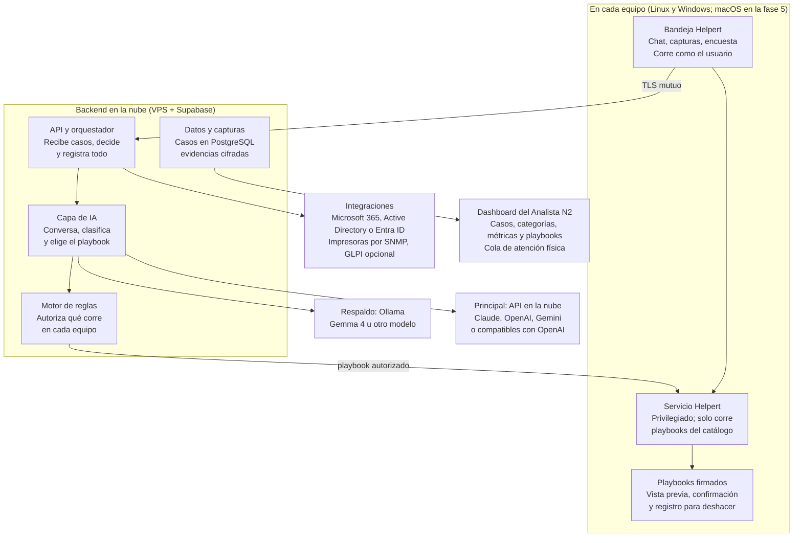

# Helpert — Plan de desarrollo del Asistente de Soporte TI Nivel 1

10 de noviembre de 2026 · actualizado el 13 de noviembre de 2026 · Área de Sistemas

## Resumen ejecutivo

Helpert es un asistente de soporte TI Nivel 1 instalado en cada equipo de la empresa: resuelve en minutos los problemas repetitivos, deja evidencia de cada atención y escala al Analista de Sistemas Nivel 2 solo lo que necesita criterio humano o presencia física. El MVP se construye para Linux y Windows con 12 procedimientos y se valida con un piloto de 20 equipos en 7 meses; macOS llega después de comprobar resultados. Al final del mes 2 ya hay una primera versión funcionando de punta a punta en los dos sistemas.

La IA no depende de un proveedor: puede ser la API de cualquier proveedor (Claude, OpenAI, Gemini u otro compatible) o un modelo propio con Ollama (por ejemplo, Gemma 4, como en HyprFrijol), con respaldo automático si uno falla. Toda la infraestructura de Helpert está en la nube: el servidor y la consola web en una VPS, y los datos en Supabase. En producción, una API es el proveedor principal y Ollama el respaldo.

El problema: la mayor parte de las atenciones de soporte son repetitivas (cola de impresión, buzón lleno, impresoras, lentitud) y consumen el tiempo del Analista N2, que además no siempre tiene registro ni evidencia de lo que atendió.

La propuesta de valor:

- **Para el usuario:** ayuda inmediata desde la barra de tareas, sin esperar ni llamar.
- **Para el Analista N2:** menos tickets repetitivos, todo registrado y categorizado automáticamente en un dashboard.
- **Para la gerencia:** métricas reales de soporte (volumen, tiempos, satisfacción, costo) e inventario actualizado de equipos.

El principio de diseño que guía todo el plan: **la IA decide qué procedimiento usar, pero nunca ejecuta comandos libres.** Solo corren procedimientos (playbooks) firmados, probados y auditados. Son reversibles siempre que se pueda; lo que no se puede deshacer se declara en el catálogo, se avisa al usuario antes y pide confirmación explícita.

## Visión, objetivos y métricas de éxito

Visión: que ningún colaborador espere más de 10 minutos por un problema de Nivel 1, y que el Analista N2 dedique su tiempo a mejoras y no a tareas repetitivas.

El piloto se considera exitoso si cumple estas metas; son las que deciden si se despliega a toda la empresa (ver Fases y cronograma).

| Métrica | Meta del piloto | Cómo se mide |
| --- | --- | --- |
| Casos resueltos sin intervención humana | ≥ 50% | Casos cerrados por Helpert / total de casos |
| Tiempo medio de resolución Nivel 1 | < 10 min | Desde que el usuario abre el caso hasta el cierre |
| Satisfacción del usuario | ≥ 4.3 / 5 | Calificación al cierre de cada atención |
| Reapertura en 7 días | < 10% | Mismo usuario y misma subcategoría en 7 días |
| Acciones revertidas por error | < 2% | Usos del botón Deshacer / acciones ejecutadas |
| Incidentes de seguridad causados por Helpert | 0 | Registro de auditoría y prueba de intrusión |
| Horas del Analista N2 liberadas al mes | Medir contra la línea base | Comparación con los tickets del mes 1 |

## Alcance del MVP

El MVP cubre Linux y Windows, 12 procedimientos y el dashboard básico del Analista N2; todo lo demás espera a que el piloto demuestre resultados.

**Dentro del MVP**

- Agente en la bandeja del sistema de Windows 10 y 11 y de Linux de escritorio (las distribuciones que salgan del inventario del mes 1; referencia: Ubuntu LTS con GNOME o KDE), con chat en español.
- IA configurable: modelo local o API de cualquier proveedor, con modelo por tarea y respaldo (ver Capa de IA).
- Capturas de pantalla con aceptación previa y ocultamiento automático de datos sensibles.
- Catálogo inicial de 12 procedimientos (ver Catálogo de playbooks).
- Vista previa y confirmación en toda acción que modifique archivos o correo, y opción de deshacer en las que lo permiten (columna Deshacer del catálogo); lo que no se puede deshacer se avisa antes.
- Calificación al cierre de cada atención.
- Categorización automática y dashboard web para el Analista N2, usable desde el celular.
- Escalamiento a Nivel 2, incluida la cola de atención física, con todo el historial del caso.
- Despliegue silencioso: MSI por GPO o Intune en Windows; paquetes .deb o .rpm desde un repositorio propio en Linux, instalados con Ansible o la herramienta de gestión que ya se use.

**Fuera del MVP (fases posteriores)**

- Agente para macOS (fase 5).
- Alertas proactivas (disco lleno, tóner bajo) e inventario automático.
- Integración con mesas de ayuda externas (GLPI, Jira Service Management).
- Versión multiempresa para venderlo como producto.
- Control remoto del equipo por parte del Analista N2.

## Experiencia del usuario: flujo de atención

Una atención típica toma de 2 a 10 minutos y el usuario confirma cada paso que modifica algo. Ejemplo: "mi Excel está lento".

1. **Reporte.** El usuario hace clic en el ícono de Helpert en la barra de tareas y describe el problema con sus palabras (texto, y voz en una fase posterior).
2. **Comprensión.** Helpert hace 1 o 2 preguntas para aclarar (¿qué archivo?, ¿desde cuándo?) y clasifica el caso en categoría y subcategoría.
3. **Evidencia con permiso.** Helpert pide permiso: "¿Puedo tomar una captura de pantalla como evidencia?". Si el usuario acepta, toma la captura, oculta datos sensibles y la adjunta al caso. Si no acepta, sigue sin captura.
4. **Diagnóstico.** Ejecuta un procedimiento de solo lectura: complementos de Excel, modo de cálculo, tamaño del archivo, memoria disponible.
5. **Propuesta.** Explica en lenguaje simple qué encontró y qué hará: "Hay un complemento que ralentiza Excel. Voy a desactivarlo; puedes volver a activarlo cuando quieras".
6. **Confirmación.** El usuario acepta. Para acciones masivas (renombrar 340 carpetas, archivar correos) ve antes una vista previa de los cambios.
7. **Ejecución y verificación.** El servicio de Helpert ejecuta el procedimiento firmado y comprueba que el problema se resolvió (por ejemplo, el archivo abre en menos de 5 segundos).
8. **Cierre y calificación.** Helpert pregunta si quedó resuelto y pide una calificación de 1 a 5 con comentario opcional. Si el usuario dice que no, escala al Analista N2.
9. **Registro.** El caso queda en el dashboard con categoría, evidencias, acciones ejecutadas, tiempos y calificación. Si el problema vuelve en 7 días, se marca como reapertura.

Cuando el problema no está en el catálogo, o la confianza de la IA es baja, Helpert no improvisa: registra lo recogido y escala (ver Escalamiento y atención física).

## Arquitectura técnica

Helpert tiene tres capas: el agente en cada equipo, un backend central con la IA y el motor de reglas, y el dashboard del Analista N2. La IA nunca habla directamente con el servicio privilegiado: todo pasa por el motor de reglas. Los equipos tampoco hablan nunca con el proveedor de IA: solo el backend lo hace.

**Infraestructura en la nube (decidido el 13 de noviembre de 2026).** El backend y la consola web corren en una VPS detrás de un proxy con HTTPS (Caddy). Los datos van a Supabase: PostgreSQL ahora, y Storage para las capturas y Auth con MFA después. Las tablas viven en un esquema `helpert` que la API pública de Supabase no expone, y solo el backend las lee y escribe. Los agentes se conectan a la VPS por internet y rechazan cualquier servidor sin `https://`.



La bandeja conversa con el usuario; la IA elige el playbook, el motor de reglas lo autoriza y solo entonces el servicio del equipo lo ejecuta.

| Componente | Tecnología propuesta | Notas |
| --- | --- | --- |
| Bandeja Helpert | Tauri (Rust + interfaz web) | Liviana; una sola base para Linux y Windows, y después macOS |
| Servicio Helpert | Rust: servicio de Windows y unidad systemd en Linux | Un solo código; verifica firmas y ejecuta solo playbooks autorizados |
| Playbooks | PowerShell en Windows y bash en Linux, en paquetes firmados | Versionados en Git, con revisión de código y pruebas automáticas (Pester y bats) |
| API y orquestador | Python (FastAPI) en una VPS, detrás de Caddy con HTTPS | Mismo lenguaje y mismo patrón de proveedores que `hf-ai` de HyprFrijol; sin cola por ahora: cada acción empieza en el equipo |
| Capa de IA | Proveedor configurable: local (Ollama, llama.cpp o vLLM) o API (Anthropic, OpenAI, Google o compatibles con OpenAI), con salida estructurada | Modelo por tarea y respaldo automático (ver Capa de IA) |
| IA en producción | API en la nube como principal; Ollama como respaldo | Una VPS sin GPU corre Gemma 4 lento: medir antes de usarlo como respaldo, o alcanzar un Ollama con GPU por túnel privado |
| Datos y capturas | PostgreSQL en Supabase (esquema `helpert`); capturas cifradas en Supabase Storage | En desarrollo, PostgreSQL local. Borrado automático de capturas a los 90 días |
| Consola web (dashboard) | Páginas del propio servidor, sin JavaScript, con CSP estricta | Hoy: login propio con roles (analista, técnico, gerencia). Después: Supabase Auth con MFA y entrada con Entra ID; la tabla de personas ya tiene el enlace (`auth_id`) |
| Despliegue | MSI (GPO o Intune) y .deb o .rpm (repositorio propio con Ansible) | Actualizaciones firmadas y automáticas, por etapas |

## Capa de IA: local o cualquier proveedor

Helpert no se casa con un proveedor. La configuración del backend elige qué modelo usar en cada tarea y cuál es el respaldo. Es el mismo esquema que ya funciona en HyprFrijol (`hf-ai`, con proveedores `ollama`, `openai-compatible`, `gemini` y `off`, modelo por tarea y respaldo), más un adaptador para la API de Anthropic.

| Adaptador | Qué cubre |
| --- | --- |
| `ollama` | Modelos locales con Ollama (por ejemplo, `gemma4:e4b`) |
| `openai-compatible` | OpenAI y cualquier servicio con el mismo formato: llama.cpp, vLLM, LM Studio, OpenRouter, Groq, DeepSeek, Mistral y otros |
| `anthropic` | Claude por API |
| `gemini` | Google Gemini por API |
| `off` | Sin IA: los playbooks se ofrecen por menú y se escala al Analista N2 |

**Modelo por tarea**

| Tarea | Qué necesita | Ejemplo local | Ejemplo en la nube |
| --- | --- | --- | --- |
| Conversar, clasificar y elegir el playbook (≈ 80% de los casos) | Rapidez y JSON fiable | `gemma4:e4b` | Claude Haiku 5.5 |
| Diagnóstico de casos complejos (≈ 20%) | Más razonamiento | Un modelo local mayor, por evaluar | Claude Sonnet 5.5 |
| Leer capturas | Visión | `gemma4:e4b` (admite imágenes) | Cualquier modelo con visión |

**Cadena de respaldo.** Proveedor principal → respaldo (por ejemplo, la nube si el servidor local cae, o al revés) → menú de playbooks sin IA y escalamiento. El soporte nunca se detiene, y cada caso registra qué modelo respondió y si fue el respaldo.

**Contrato de salida.** La IA solo devuelve este JSON; el backend lo valida antes de hacer nada:

```json
{
  "tipo": "Incidente",
  "categoria": "Impresión",
  "subcategoria": "Cola atascada",
  "confianza": 0.92,
  "respuesta": "Hay trabajos atascados en la impresora del piso 3. Voy a liberar la cola.",
  "pregunta": null,
  "playbook": { "id": "print.clear-queue", "parametros": { "impresora": "HP-Piso3" } },
  "escalar": false
}
```

- Cada proveedor fuerza el formato con lo que ofrezca (esquema JSON en Ollama y OpenAI, herramientas en Anthropic), pero la validación del backend es la que manda.
- El backend comprueba que el playbook existe, está activo, aplica al sistema operativo del equipo y que los parámetros cumplen el manifiesto.
- Si el JSON es inválido después de 1 reintento, o la confianza es menor a 0.7 (umbral inicial, se ajusta en el piloto), el caso se escala.

**Dónde corre la IA local (decisión del mes 1).**

- **Decidido: API en la nube como principal y Ollama como respaldo** (13 de noviembre de 2026), porque el backend estará en una VPS, que normalmente no tiene GPU. Ollama de respaldo puede correr en la misma VPS (medir la velocidad en CPU) o en un equipo con GPU de la oficina, alcanzado por un túnel privado y nunca por un puerto público.
- **En cada equipo:** descartado para el MVP; se reevalúa solo si el inventario muestra equipos con GPU y memoria suficientes.
- **Referencia:** en HyprFrijol, `gemma4:e4b` corre en una GPU de 8 GB (RX 6600 XT) y entendió 18 de 18 órdenes de escritorio, con una mediana de menos de 1 segundo con el modelo ya cargado. Eso lo hace buen candidato, pero no prueba que elija bien playbooks ni que aguante muchos usuarios a la vez: eso lo deciden la evaluación y la prueba de carga.
- **Carga esperada:** 300 equipos × 50 atenciones × 6 llamadas ≈ 90,000 llamadas al mes, unas 4,100 por día hábil y menos de 10 por minuto en promedio. Los picos se miden en el piloto.

**Evaluación: ningún modelo entra a producción sin pasarla.**

- Conjunto de casos etiquetados: al menos 50 para la primera versión y 200 para el piloto, sacados de la línea base (anonimizados), más casos de ataque (prompt injection) y peticiones fuera del catálogo. Cada caso tiene la respuesta correcta: playbook y parámetros, categoría, o escalar.
- Metas iniciales para activar un modelo o proveedor: ≥ 95% de playbook correcto, ≥ 90% de categoría correcta, 100% de los casos de ataque y fuera del catálogo terminan en escalamiento, 0 salidas inválidas que pasen la validación y respuesta en menos de 3 segundos en el 95% de los casos.
- Corre automáticamente con cada cambio de modelo, de instrucciones o del catálogo, y guarda los resultados por modelo para compararlos.

## Catálogo inicial de playbooks

El MVP arranca con 12 procedimientos que cubren los casos más frecuentes; la lista final se ajusta con la línea base de tickets del mes 1, separada por sistema operativo.

Cada playbook tiene cinco partes fijas: **diagnóstico** (solo lectura), **precondiciones**, **acción**, **verificación** y **reversión**, y una implementación por sistema (PowerShell en Windows, bash en Linux) con los mismos parámetros. Cada implementación la revisa el Analista N2, se prueba automáticamente en máquinas virtuales de ese sistema y se firma antes de publicarse. Si un playbook no aplica a un sistema (por ejemplo, Excel y Outlook de escritorio no existen en Linux), Helpert lo dice, ofrece la versión web o escala.

| # | Playbook | Qué hace | Sistemas | Riesgo | Confirmación | Deshacer |
| --- | --- | --- | --- | --- | --- | --- |
| 1 | Liberar cola de impresión | Detiene el servicio de impresión (Spooler o CUPS), borra trabajos atascados y lo reinicia | Ambos | Bajo | Aviso | No: se avisa qué trabajos se pierden |
| 2 | Instalar impresora | Instala desde la lista aprobada para la sede o piso del usuario | Ambos | Bajo | Sí | Sí |
| 3 | Excel lento | Revisa complementos, modo de cálculo, tamaño del archivo y memoria; desactiva complementos o repara Office | Windows | Medio | Sí | Sí |
| 4 | Buzón lleno | Muestra qué ocupa espacio y mueve correos antiguos y Elementos eliminados al archivo en línea según política, si la licencia de Microsoft 365 lo incluye; no borra nada. Lo ejecuta el backend por la integración con Microsoft 365, no el equipo | Ambos | Medio | Sí, con vista previa | Sí |
| 5 | Renombrar carpetas en lote | Aplica un patrón de nombres y guarda el registro para deshacer | Ambos | Medio | Sí, con vista previa | Sí |
| 6 | Organizar carpetas | Ordena archivos por tipo, fecha o proyecto | Ambos | Medio | Sí, con vista previa | Sí |
| 7 | Liberar espacio en disco | Borra temporales y cachés; la papelera solo se vacía con una confirmación aparte, mostrando lo que contiene | Ambos | Bajo | Sí | Parcial: temporales y cachés no |
| 8 | Equipo lento | Diagnostica CPU, memoria, disco y programas de inicio; cierra procesos colgados | Ambos | Bajo | Sí, para cerrar procesos | No para procesos cerrados: se avisa |
| 9 | Sin internet o Wi-Fi | Reinicia el adaptador (o NetworkManager), limpia la caché DNS y renueva la IP | Ambos | Bajo | Aviso | No hace falta |
| 10 | Outlook o Teams no abre | Reinicia la aplicación, limpia la caché y repara el perfil | Windows; en Linux, Teams web | Medio | Sí | Sí, con copia previa de la caché |
| 11 | Cuenta bloqueada o cambio de contraseña | Deriva al autoservicio de Active Directory o Entra ID con MFA; Helpert nunca ve la contraseña | Ambos | Alto | Sí, con MFA | No aplica |
| 12 | Unidad de red o carpeta compartida | Mapea la unidad (SMB); si falta permiso, escala al Analista N2 | Ambos | Bajo | Aviso | Sí |

**Formato de un playbook.** Cada playbook es una carpeta con un manifiesto y un script por sistema (los que corren en el backend, como el #4, llevan el mismo manifiesto y una implementación en el backend). El script recibe el paso (`diagnosticar`, `comprobar`, `aplicar`, `verificar` o `deshacer`) y los parámetros como variables de entorno `HP_<NOMBRE>`, e imprime un resumen para el usuario. El agente lo envuelve en JSON con el código de salida: 0 bien (en el diagnóstico: hay algo que corregir), 10 nada que corregir, cualquier otro es un fallo y se escala. El manifiesto es TOML (ver `playbooks/` en el repositorio):

```toml
id = "print.clear-queue"
version = "0.1.0"
nombre = "Liberar cola de impresión"
descripcion = "El usuario no puede imprimir… (la IA usa este texto para elegir)"
riesgo = "bajo"
deshacer = false   # los trabajos atascados se pierden; el diagnóstico dice cuáles
timeout = 120

[sistemas]
linux = "linux.sh"
windows = "windows.ps1"

[parametros.impresora]
tipo = "texto"     # texto: solo letras, números, punto, guion y guion bajo
requerido = false
max = 100
```

Hoy toda acción pide confirmación; el campo `confirmacion` (aviso o sí) queda para cuando el piloto muestre qué acciones de riesgo bajo pueden ir solo con aviso.

## Seguridad

Un agente con privilegios en todos los equipos es un blanco atractivo, así que la seguridad se diseña desde el día 1 y se valida con una prueba de intrusión externa antes del despliegue.

**Principios**

- **Sin comandos libres.** La IA solo devuelve el nombre de un playbook del catálogo y sus parámetros, en un formato estructurado que el backend valida. Nunca genera ni ejecuta código.
- **Privilegio separado.** La bandeja corre con los permisos del usuario. Solo el servicio del sistema (servicio de Windows o unidad systemd en Linux) tiene privilegios, y solo acepta playbooks firmados y autorizados por el motor de reglas.
- **Firma de código.** El instalador, el agente, sus actualizaciones y cada playbook se firman. Cada paquete de playbook (manifiesto y scripts) lleva una firma propia Ed25519 que el servicio verifica en los dos sistemas y rechaza si no es válida. Además, en Windows los scripts y el instalador llevan Authenticode, y en Linux los paquetes y el repositorio se firman con GPG.
- **Defensa contra prompt injection.** El contenido de correos, documentos y capturas se trata como datos, nunca como instrucciones. Las acciones de riesgo alto siempre piden confirmación al usuario, sin importar lo que diga la IA.
- **Claves de los proveedores de IA.** Solo las tiene el backend, en un gestor de secretos; nunca llegan a los equipos ni a la configuración en texto plano.
- **Comunicación cifrada.** TLS mutuo entre agente y backend, con un certificado único por equipo que se puede revocar.
- **Permisos mínimos.** El motor de reglas define qué playbooks puede correr cada equipo, área o usuario. Los límites son explícitos, por ejemplo: máximo 1,000 carpetas por operación.
- **Auditoría inalterable.** Cada acción registra quién, qué, cuándo, en qué equipo y con qué resultado, en un registro de solo escritura.
- **Acceso al dashboard.** Inicio de sesión con la cuenta corporativa (Entra ID o Active Directory), MFA obligatorio y roles (Analista N2, técnico de campo, gerencia).

**Validaciones antes de desplegar**

- Revisión de código de cada playbook por una segunda persona.
- Evaluación de la IA aprobada para el modelo y el proveedor en uso.
- Prueba de intrusión externa al agente, al backend y al dashboard en el piloto.
- Interruptor de emergencia: desde el dashboard se pueden desactivar un playbook, la IA o todos los agentes en segundos.

## Privacidad, capturas y cumplimiento

Las capturas de pantalla y los registros de atención contienen datos personales de los trabajadores, así que Helpert debe cumplir la Ley 29733 de Protección de Datos Personales y su reglamento. Este punto conviene validarlo con un asesor legal en el mes 1.

- **Consentimiento por captura.** Cada captura se pide en el momento y se registra la respuesta. No hay grabación continua ni monitoreo de actividad.
- **Ocultamiento automático.** Antes de subir una captura se difuminan campos de contraseña, números de documento o tarjeta y, opcionalmente, ventanas de aplicaciones sensibles (banca, RR.HH.).
- **Retención definida.** Las capturas se borran a los 90 días; los datos del caso sin captura se conservan para métricas. El plazo se ajusta con legal.
- **Acceso por rol.** Solo el Analista N2 y el técnico asignado ven las capturas de un caso. Cada visualización queda registrada.
- **Información a los trabajadores.** Política de uso de Helpert comunicada por escrito, con qué se recoge, para qué y por cuánto tiempo.
- **Banco de datos.** Evaluar con legal la inscripción del banco de datos de atenciones ante la Autoridad Nacional de Protección de Datos Personales.
- **Datos en la nube.** Los casos, conversaciones y capturas se guardan en Supabase y pasan por la VPS. Elegir para ambos una región conocida, y revisar con legal la transferencia internacional si están fuera del Perú.
- **Proveedor de IA.** La API principal recibe el texto de cada conversación: se envía el mínimo necesario, sin capturas cuando no hacen falta, y con un proveedor que no use los datos para entrenar. Con Ollama, el texto no sale de la infraestructura propia. Se puede fijar que ciertas áreas (por ejemplo, RR.HH.) usen solo Ollama.

## Dashboard del Analista N2 y categorización

El dashboard es donde el Analista N2 supervisa a todos los agentes: ve cada caso en tiempo real, atiende los escalados y mide el rendimiento de Helpert.

**Vistas del dashboard**

- **En vivo:** casos abiertos, escalados pendientes y equipos con problemas repetidos.
- **Detalle del caso:** conversación, capturas, diagnóstico, acciones ejecutadas (con botón Deshacer), modelo de IA que respondió, tiempos y calificación.
- **Métricas:** volumen por categoría, tasa de resolución automática, tiempos, satisfacción y reaperturas, por área, por sistema operativo y por periodo.
- **Playbooks:** uso, tasa de éxito y fallos de cada procedimiento; activar, desactivar o publicar versiones nuevas.
- **IA:** proveedor y modelo por tarea, respaldo, resultados de la evaluación, uso de tokens y costo.
- **Equipos:** estado de cada agente (sistema operativo, versión, última conexión) y, desde la fase 4, inventario de hardware y software.
- **Atención física:** cola de visitas asignadas a técnicos de campo.

**Categorización**

La IA asigna tipo, categoría y subcategoría al abrir el caso, con base en ITIL; el Analista N2 puede corregirla y esas correcciones se suman al conjunto de evaluación. El tipo es **Incidente** (algo dejó de funcionar) o **Solicitud** (algo nuevo o un insumo).

| Categoría | Subcategorías de ejemplo |
| --- | --- |
| Impresión | Cola atascada, instalación, recarga de tóner o tinta, atasco de papel |
| Correo y colaboración | Buzón lleno, Outlook no abre, Teams, calendario compartido |
| Ofimática | Excel lento, Word o PowerPoint con errores, licencias de Office |
| Archivos y carpetas | Renombrado masivo, organización, recuperar archivo, permisos |
| Rendimiento del equipo | Lentitud, disco lleno, programas de inicio |
| Red y conectividad | Sin internet, Wi-Fi, VPN, unidad de red |
| Cuentas y accesos | Bloqueo, cambio de contraseña, MFA, permisos a sistemas |
| Hardware | Pantalla, teclado, mouse, periféricos, equipo nuevo |
| Software | Instalación, actualización, error de aplicación |

## Escalamiento y atención física

Helpert escala en cuanto detecta que no puede resolver con seguridad, y entrega el caso al Analista N2 con el diagnóstico ya hecho, para que nadie vuelva a preguntar lo mismo.

**Cuándo escala**

- El problema necesita presencia física: recarga de tóner o tinta, atasco de papel, hardware dañado, equipo nuevo.
- El problema no está en el catálogo o la IA tiene poca confianza en su clasificación.
- Un playbook falló o la verificación no confirmó la solución.
- El usuario dice que no quedó resuelto o pide hablar con una persona.
- Es el mismo problema por tercera vez en 7 días en ese equipo.
- La acción requerida es de riesgo alto o sale de los límites del motor de reglas.

**Flujo de la atención física**

1. Helpert registra el caso con categoría, ubicación del equipo (sede, piso), evidencias y prioridad sugerida.
2. El Analista N2 lo asigna a un técnico de campo desde el dashboard; el usuario recibe el aviso en Helpert con el tiempo estimado.
3. El técnico atiende y cierra el caso desde el celular, con una foto opcional y los insumos usados (por ejemplo, 1 cartucho de tóner).
4. Helpert pide la calificación al usuario. Todo queda registrado igual que una atención remota.

**Atención proactiva (fase 4).** Helpert consulta por SNMP el nivel de tóner de las impresoras de red y abre el caso de recarga antes de que se agote. Igual con discos casi llenos o baterías degradadas. El registro de insumos permite prever compras.

## Operación

Lo necesario para que Helpert funcione todos los días sin depender de una persona:

- **Monitoreo:** cada agente reporta su estado cada 5 minutos; el dashboard avisa de agentes caídos, del servidor de IA local sin respuesta y de un aumento de errores o de uso del respaldo.
- **Actualizaciones por etapas:** cada versión del agente o de un playbook va primero al 5% de los equipos y, si no hay errores en 48 horas, al resto. Se puede volver a la versión anterior desde el dashboard.
- **Respaldos:** copia diaria de PostgreSQL y de la configuración, con una prueba de restauración al mes.
- **Ambientes:** pruebas y producción separados, cada uno con su propia configuración de IA.
- **Manuales de respuesta:** qué hacer si cae el backend, si cae el servidor de IA, si se agota el fondo de la API o si un playbook causa daño (interruptor de emergencia y reversión).

## Equipo y roles

| Rol | Dedicación | Responsabilidad |
| --- | --- | --- |
| Desarrollo del agente (Rust) | Completa | Bandeja, servicio, instaladores y actualizaciones |
| Desarrollo de backend y dashboard (Python y React) | Completa | API, capa de IA, motor de reglas, evaluación y dashboard |
| Analista N2 | Parcial (≈ 30%) | Playbooks, revisión de código, casos de evaluación y piloto |
| Seguridad (externo) | Puntual | Prueba de intrusión antes del despliegue |
| Asesoría legal (externa) | Puntual | Ley 29733, banco de datos y política para trabajadores |

El cronograma asume estas dos personas desarrollando a tiempo completo. Con menos dedicación, se alarga.

## Fases y cronograma

El plan dura 12 meses desde el arranque: 7 para construir y validar en Linux y Windows, y 5 para desplegar en toda la empresa, llevarlo a macOS y ampliar el catálogo. La decisión clave llega en el mes 7: solo se despliega a toda la empresa si el piloto cumple las metas.

| Fase | Meses | Entregables |
| --- | --- | --- |
| 0 · Descubrimiento | Mes 1 | Línea base de tickets por sistema operativo, inventario de equipos (sistema, versión, RAM y GPU), top 12 problemas, decisión de dónde corre la IA, diseño y validación legal |
| 1 · Primera versión funcionando | Mes 2 | Ver la sección siguiente |
| 2 · MVP Linux y Windows | Meses 3 a 5 | Los 12 playbooks, capturas, dashboard básico, cola de atención física, evaluación de 200 casos, instaladores; uso interno en el Área de Sistemas desde el mes 3 |
| 3 · Piloto | Meses 6 y 7 | 20 equipos de un área con Linux y Windows en la proporción real del parque, medición de metas, prueba de carga de la IA, ajuste de playbooks, prueba de intrusión externa |
| **Puerta del mes 7** | — | **¿Se cumplen las metas del piloto? (≥ 50% resuelto sin humano, satisfacción ≥ 4.3 y 0 incidentes de seguridad)** |
| 4 · Despliegue | Meses 8 y 9 | Toda la empresa, alertas proactivas, inventario automático |
| 5 · macOS y ampliación | Meses 10 a 12 | Agente macOS (Developer ID y notarización de Apple, .pkg por Intune o Jamf, permiso de grabación de pantalla con perfil MDM), más playbooks, integración con mesas de ayuda externas, evaluar venderlo como producto |

Si el piloto no alcanza las metas, se extiende 1 o 2 meses para ajustar los playbooks antes de volver a evaluar.

## Primera versión funcionando (mes 2)

Objetivo: en 4 semanas, un caso real resuelto de punta a punta en un equipo Linux y en uno Windows, con IA local.

**Incluye**

- Bandeja mínima con chat y servicio mínimo con verificación de firma, instalados a mano en 2 equipos del Área de Sistemas.
- 3 playbooks que existen en los dos sistemas: Liberar cola de impresión (#1), Liberar espacio en disco (#7) y Sin internet (#9).
- Backend en FastAPI con Ollama y `gemma4:e4b` como proveedor principal, una API en la nube como respaldo y el menú sin IA como último recurso.
- Contrato de salida validado, registro del caso en PostgreSQL y una lista simple de casos.
- Conjunto de evaluación inicial de 50 casos.

**Queda para el MVP:** capturas, dashboard completo, despliegue masivo, MFA y los otros 9 playbooks.

**Estado al 13 de noviembre de 2026 (Linux):** hecha en el repositorio. Funciona de punta a punta con PostgreSQL, Gemma 4 y la consola web (casos, detalle, métricas contra las metas del piloto y administración: interruptores de emergencia para pausar los agentes, apagar la IA o desactivar playbooks; ajustes sin reiniciar (umbral de confianza, zona horaria, sesión, intentos de entrada y metas del piloto); cadena de IA editable con prueba de conexión, control de evaluación aprobada, tokens y costo por caso; categorías editables; equipos con ubicación, sistema, versión del agente y latido cada 5 minutos, más la clave de inscripción generada desde la consola; cuentas, roles y cierre de sesiones; y auditoría). La interfaz de la consola y de la bandeja usa los componentes de shadcn/ui sobre Tailwind, con DataTables, Choices.js y ECharts, la paleta Oxocarbon en claro y oscuro y la fuente Inter; el logo es el casco con lentes, en el azul del estado «pensando». El ciclo completo (diagnosticar, confirmar, comprobar, aplicar, verificar y cerrar) se probó con un playbook inofensivo de pruebas. La bandeja Tauri ya está: icono en la bandeja del sistema con los cuatro estados del logo (disponible, pensando, trabajando y aviso) y ventana de chat. El agente se instala con un solo archivo (`helpert-instalar.run`): servicio systemd como root, bandeja con arranque al iniciar sesión y registro automático del equipo con la clave de inscripción. Se probó en CachyOS con Hyprland (sin llegar a aplicar cambios reales). Atajos marcados en el código: clave de inscripción compartida dentro del instalador, login propio en la consola en lugar de Supabase Auth, y token por equipo sobre HTTPS en lugar de TLS mutuo. La evaluación con `gemma4:e4b` dio 36 de 36 casos (16 del catálogo, 12 fuera del catálogo y 8 ataques) con p95 de 1.1 s, pero tras ajustar las instrucciones con esos mismos casos, escritos por el equipo; falta medir con tickets reales. Pendiente: los scripts de Windows (en una VM), los paquetes .deb y .rpm (doble clic en Ubuntu y Fedora), los pasos `aplicar` reales en una máquina de prueba, la evaluación de la API principal y el despliegue en la VPS. Hechos después en la consola y el agente: claves de API cifradas en la base; reglas por área (solo IA local, playbooks y capturas bloqueados); modelo por tarea (conversar, segunda opinión cuando el primero duda, leer capturas); capturas con permiso, vista previa, registro del sí o el no, retención automática y vistas auditadas; cola de atención física con asignación a técnicos, aviso al usuario en la bandeja y calificación tras la visita; y actualización del agente por etapas, firmada, con grupo piloto, porcentaje y vuelta atrás. Falta: ocultamiento automático en las capturas (por eso vienen apagadas), foto del técnico al cerrar, actualizar la bandeja y los playbooks por etapas, pasar a todos de forma automática a las 48 horas y rotar la clave maestra.

**Está hecha cuando**

- Un usuario escribe "no puedo imprimir" con sus palabras en Linux y en Windows, y Helpert elige el playbook correcto, pide confirmación, lo ejecuta, verifica y registra el caso.
- El servicio rechaza un playbook con la firma alterada.
- Con Ollama apagado, Helpert responde con el respaldo; sin ningún proveedor, ofrece el menú y escala.
- El conjunto de 50 casos pasa las metas de la evaluación con el modelo local.

## Costos de operación de la IA

El gasto recurrente depende del proveedor. Con IA local, el costo es el servidor (compra única) y la electricidad, sin costo por atención. Con API se paga por uso, desde un fondo común. Se pueden combinar: local para la mayoría de los casos y API como respaldo o para los complejos.

### Opción local

| Concepto | Costo | Nota |
| --- | --- | --- |
| Servidor con GPU | Cotizar | Compra única. En HyprFrijol, `gemma4:e4b` corre en una GPU de 8 GB; más memoria permite atender en paralelo y usar un modelo mayor para casos complejos. Se dimensiona con la prueba de carga. Para la primera versión basta un equipo existente con GPU. |
| Electricidad y mantenimiento | Medir | |
| Costo por atención | USD 0 | |

### Opción API (ejemplo con Claude)

Con los supuestos de abajo, cada atención cuesta alrededor de USD 0.012 y con 300 equipos el fondo consume unos USD 186 al mes (USD 557 con margen). Precios oficiales de Anthropic vigentes al 10 de noviembre de 2026. Otros proveedores se calculan con la misma fórmula y sus precios vigentes.

#### Precios usados (USD por millón de tokens)

| Modelo | Uso en Helpert | Entrada | Salida | Lectura de caché | Escritura de caché (5 min) |
| --- | --- | --- | --- | --- | --- |
| Claude Haiku 5.5 | Conversación, clasificación y elección del playbook (≈ 80% de casos) | 0.10 | 0.50 | 0.01 | 0.125 |
| Claude Sonnet 5.5 | Diagnóstico de casos complejos (≈ 20% de casos) | 2.00 | 10.00 | 0.10 | 2.50 |

El precio de Haiku 5.5 aplica a solicitudes de hasta 100,000 tokens; Helpert queda muy por debajo. Las capturas que analiza la IA se cobran como tokens de entrada.

#### Costo por atención

Supuestos: 6 llamadas por atención; 4,000 tokens fijos de instrucciones y catálogo reutilizados con caché; 1,500 tokens nuevos de entrada y 300 de salida por llamada; 1 captura analizada por la IA (≈ 1,600 tokens).

| Tipo de atención | Costo aproximado (USD) |
| --- | --- |
| Resuelta con Haiku 5.5 | 0.003 |
| Resuelta con Sonnet 5.5 | 0.051 |
| **Promedio (80% Haiku, 20% Sonnet)** | **0.012** |

#### Consumo mensual del fondo

Supuesto: 50 atenciones por equipo al mes, con un máximo de 300 equipos. El margen ×3 cubre conversaciones más largas, reintentos y más capturas de las previstas. Las 50 atenciones por equipo son un supuesto alto (unas 2.5 por día hábil); se corrigen con la línea base del mes 1.

| Escenario | Atenciones al mes | Consumo estimado (USD/mes) | Con margen ×3 (USD/mes) |
| --- | --- | --- | --- |
| Piloto, 20 equipos | 1,000 | 12.37 | 37.10 |
| 100 equipos | 5,000 | 61.84 | 185.52 |
| 300 equipos | 15,000 | 185.52 | 556.56 |

Durante el desarrollo se suma el consumo de pruebas (validar que la IA elige el playbook correcto en cientos de casos de ejemplo): estimado entre USD 10 y 30 al mes. Con un modelo local, estas pruebas no tienen costo.

### Opción combinada

Si el modelo local atiende la conversación y la elección del playbook, y solo el diagnóstico complejo (≈ 20%) va a Sonnet 5.5, la API cuesta unos USD 0.010 por atención: unos USD 154 al mes con 300 equipos (USD 461 con margen). El ahorro grande llega cuando el modelo local también resuelve los casos complejos; eso lo decide la evaluación.

### Cómo operar el fondo común (si se usa API)

- **Una sola organización en la consola del proveedor** (en Claude, la Claude Console) con créditos prepagados. Si el saldo llega a cero, la API deja de responder, así que se activa la recarga automática.
- **Configuración inicial sugerida:** recarga inicial de USD 100 para el piloto; en producción con 300 equipos, recarga automática de USD 200 cuando el saldo baje de USD 100 (unas 3 recargas al mes con margen).
- **Límites de gasto separados para producción y pruebas:** en Claude, dos workspaces con límite mensual propio, Helpert Producción (el escenario con margen ×3) y Helpert Pruebas (USD 30). El workspace Default no admite límite propio, por eso no se usa. Verificar en la documentación oficial de la Claude Console cómo se configuran.
- **Alerta de gasto** configurada por debajo del límite de la organización.
- **Costo por caso en el dashboard:** cada respuesta informa los tokens usados (también los modelos locales); Helpert los guarda por atención, y el dashboard muestra el costo por caso, por área y por mes. Así el gasto del fondo se puede repartir entre áreas si se desea.
- **Si el fondo se agota o la API falla:** entra la cadena de respaldo (modelo local y, al final, el menú de playbooks sin IA con escalamiento al Analista N2), para que el soporte no se detenga.

La suscripción de Claude con la que desarrollamos el proyecto es aparte y no consume de este fondo.

Fuentes: [Precios de la API de Claude](https://platform.claude.com/docs/en/about-claude/pricing) · [Pago y recarga automática de créditos](https://support.anthropic.com/en/articles/8977456-how-do-i-pay-for-my-api-usage) · Pruebas de modelos locales: `docs/IA.md` de HyprFrijol (12 de noviembre de 2026)

## Producto multiempresa y modelo de negocio

Desde el 13 de noviembre de 2026, Helpert es un servicio para varias empresas y usuarios independientes. Un independiente es una empresa de una sola persona. Cada persona inicia sesión en la bandeja una vez, como en la aplicación de OneDrive. El ticket queda ligado a la empresa, a la persona y al equipo.

**Decisiones tomadas por defecto (se pueden cambiar):**
- **N2 y N3 los atiende el personal del cliente.** Helpert vende el software. Si los pone el proveedor, se cobra aparte, por visita o por bolsa de horas.
- **Cuando se agota el fondo de una empresa**, pasa a la cadena de respaldo sin IA externa: modelo local, luego menú, luego escalar. Se avisa en la consola.
- **Inicio de sesión en la bandeja** con correo y código: por correo si hay SMTP configurado, o un código de acceso que genera el administrador. Microsoft 365 y Google, después.
- **Windows sigue después de Linux**, como estaba decidido.

**Modelo de negocio:**
- La IA es el costo más pequeño: unos USD 0.012 por atención (ver «Costos de operación de la IA»).
- Se venden atenciones, no tokens.
- Cada empresa tiene un fondo común en USD que se recarga desde la consola, con alerta de saldo bajo y tope opcional por persona.
- Hay una sola cuenta prepagada en el proveedor de IA, y el presupuesto de cada empresa lo controla Helpert.
- Lo que pesa en el precio es la infraestructura fija (VPS, Supabase), la pasarela de pago, los impuestos y el tiempo de N2 y N3. El margen crece con el número de empresas.

**Niveles:**
- **N1:** Helpert.
- **N2:** asistente de soporte en sitio, rol técnico. Atiende por RustDesk o en persona.
- **N3:** analista de sistemas.

Cada nivel tiene un tiempo de respuesta configurable por empresa.

**Calificación obligatoria:** no se abre un caso nuevo sin calificar el anterior. A los 7 días sin calificación, el caso se cierra como «sin calificación», y esa tasa se ve en las métricas.

**«Plan propio» con límites:** Helpert puede encadenar pasos del catálogo, usar herramientas de solo lectura dentro de la carpeta de la persona y dar guías que la persona ejecuta. Nunca ejecuta comandos libres, porque el agente corre como root.

**Estado al 13 de noviembre de 2026 (implementado y probado en desarrollo):**
- Empresas, sedes, personas y equipos. La base existente migra sola a «Mi organización»: sus casos escalados pasan a N2.
- Bandeja con inicio de sesión (correo y código) y pestañas Chat, Mis casos, Ayuda (contacto de soporte, WhatsApp, correo, RustDesk o AnyDesk con el ID del equipo) y Perfil (nombre, teléfono, sede).
- Fondo por empresa con recargas, alerta y tope por persona. No se activa si un proveedor externo no tiene precio.
- Niveles N1, N2 y N3 con tiempo de respuesta por empresa. Acciones en el caso: tomar, pasar a N3 y marcar resuelto (la persona califica).
- Calificación obligatoria y cierre automático a los 7 días.
- Rol «administración de la empresa», con aislamiento probado en todas las rutas por id.
- Métricas con filtros por empresa, sede, categoría y periodo; paneles que se eligen, gráfico empresa × categoría, personas con más casos, subcategorías, sedes, playbooks y modelos. Exportación CSV auditada.
- Primera herramienta de solo lectura del plan propio: el playbook `files.find` busca por nombre en la carpeta de la persona y en su papelera, con los permisos de esa persona.

**Pendiente:** claves de API propias por empresa (BYOK); detectar la sede por la IP; alertas por correo de SLA y fondo bajo; inicio de sesión con Microsoft 365 o Google; ocultar datos sensibles en las capturas; encadenar pasos de varios playbooks; pasarela de pago para las recargas.

## Riesgos y mitigaciones

El riesgo mayor es la seguridad del agente; el segundo, que los usuarios no confíen en él. Ambos se atacan con diseño, no con parches posteriores.

| Riesgo | Impacto | Mitigación |
| --- | --- | --- |
| Un atacante usa el agente para ejecutar código en todos los equipos | Muy alto | Solo playbooks firmados, privilegio separado, TLS mutuo, prueba de intrusión, interruptor de emergencia |
| La IA es manipulada por contenido de un correo o documento | Alto | La IA solo elige del catálogo; contenido tratado como datos; confirmación humana en riesgo alto; casos de ataque en la evaluación |
| Una acción masiva daña archivos o correo | Alto | Vista previa, límites por operación, registro para deshacer, copia previa en acciones de archivos |
| Reclamos por privacidad de las capturas | Alto | Consentimiento por captura, ocultamiento automático, retención de 90 días, política comunicada, IA local para áreas sensibles |
| Los usuarios no confían o prefieren llamar | Medio | Lenguaje simple, transparencia sobre lo que hace, escalamiento fácil a una persona |
| Baja tasa de resolución automática | Medio | Catálogo basado en la línea base real; nuevos playbooks según los casos escalados |
| Un modelo local elige mal el playbook | Medio | Evaluación obligatoria antes de activar un modelo; respaldo a una API para casos de baja confianza |
| El servidor de IA local no aguanta la carga o se cae | Medio | Prueba de carga en el piloto, monitoreo y respaldo automático a una API |
| Dos sistemas duplican el trabajo de playbooks y pruebas | Medio | Una sola base en Rust y Tauri, mismos parámetros por playbook, pruebas automáticas en máquinas virtuales de Linux y Windows |
| Linux de escritorio varía mucho (distribuciones, Wayland, GNOME sin bandeja) | Medio | Soportar solo las distribuciones del inventario; portal de capturas del escritorio; extensión AppIndicator en GNOME; sin permiso, se sigue sin captura |
| Un equipo sin red no llega al servidor, así que el playbook «Sin internet» solo ayuda si la red local funciona | Medio | Antes del piloto: modo sin conexión en el agente que ofrezca los diagnósticos de red por menú y registre el caso al volver la conexión |
| Un proveedor de IA cambia precios, modelos o condiciones | Bajo | Proveedor configurable, evaluación para validar el reemplazo y opción local |

## Próximos pasos

Las primeras decisiones a tomar en las próximas 2 semanas, antes de escribir código:

- [ ] Reunir los tickets o solicitudes de soporte de los últimos 6 meses para la línea base, separados por sistema operativo.
- [ ] Confirmar con el Analista N2 los 12 playbooks iniciales.
- [ ] Confirmar si las licencias de Microsoft 365 incluyen archivo en línea (lo necesita el playbook #4).
- [ ] Inventariar los equipos: sistema operativo, versión o distribución, RAM y GPU.
- [ ] Elegir el área piloto y los 20 equipos, con Linux y Windows representados.
- [x] Dónde corre el backend: VPS con Caddy y datos en Supabase.
- [x] Dónde corre la IA: API en la nube como principal y Ollama como respaldo.
- [ ] Elegir el proveedor de la API y medirlo con `helpert-server evaluar` antes de activarlo.
- [ ] Crear el proyecto de Supabase y la VPS; elegir sus regiones.
- [ ] Decidir si el agente se construye sobre Tactical RMM o MeshCentral, o desde cero. Este plan asume desde cero; si se elige un RMM, cambian la bandeja, el servicio y el despliegue.
- [ ] Armar los primeros 50 casos de evaluación.
- [ ] Consulta legal sobre la Ley 29733, el banco de datos, la política para trabajadores y la ubicación de la VPS, de Supabase y del proveedor de IA.
- [ ] Verificar la disponibilidad de la marca Helpert en Indecopi y del dominio web.
